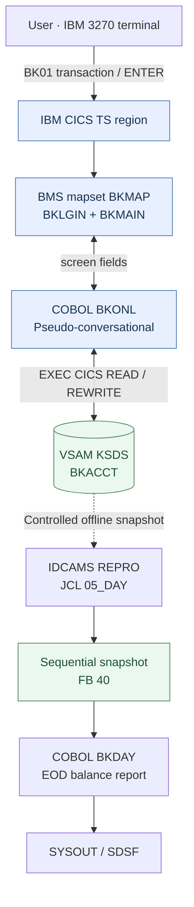
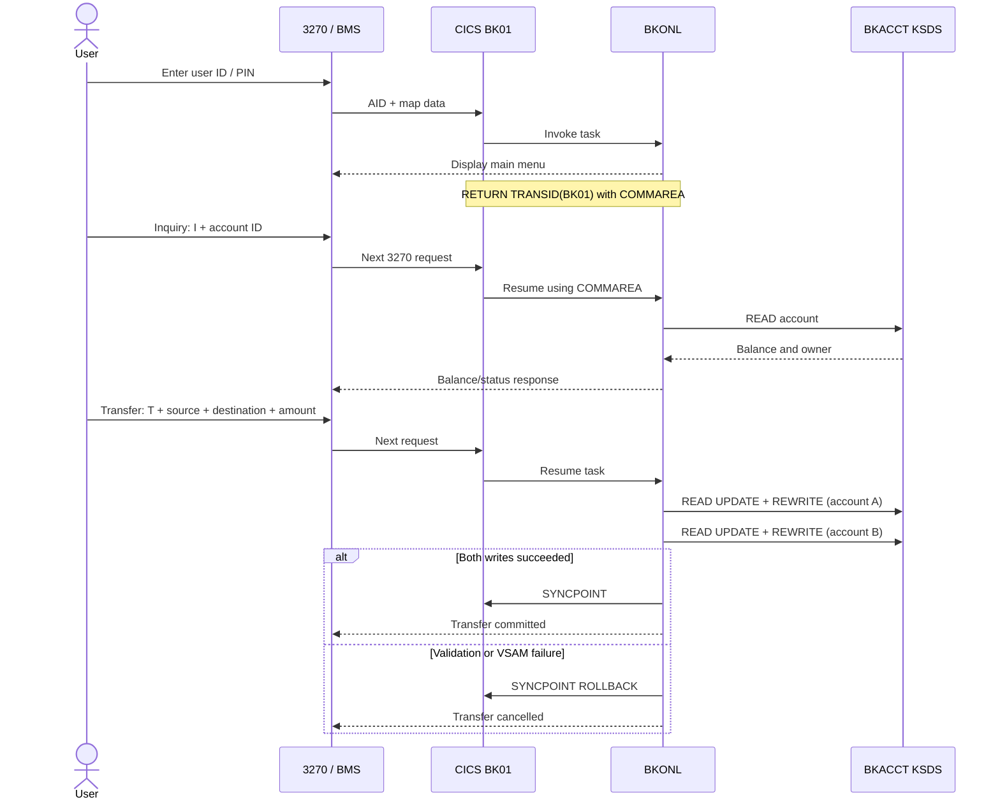

<div align="center">

# 🏦 CICS Mini Bank

### A 3270 online banking demo built with COBOL, IBM CICS, BMS, VSAM and JCL

**From a green-screen transaction to a recoverable account update and end-of-day batch report.**


[Architecture](#architecture) · [Features](#features) · [Run it on zOS](#step-by-step-deployment) · [Test scenarios](#test-the-application) · [Troubleshooting](#troubleshooting)

</div>

> [!IMPORTANT]
> **Educational source package, not a working production banking system.** This project was created as an original demonstration of the *architecture* of a CICS banking application; it is **not** the AWS CardDemo source. The source/JCL have **not been compiled, installed, or executed on a real z/OS system** as part of this repository. CICS, COBOL, JCL and site-specific resource definitions must be validated in your own lab before use. **This project uses CICS; it does not use IMS.**

## What is this project?

A minimal banking workflow accessed from a **3270 terminal**. A user signs on using training-only credentials, checks a balance, or transfers a simulated amount between accounts. IBM CICS manages the online requests and a COBOL application reads/updates a **VSAM KSDS**. A separate JCL batch job takes a controlled file snapshot and runs a COBOL end-of-day balance report.

This is useful for practicing how **online transaction processing** and **overnight batch processing** fit together in traditional IBM Z applications.

## Features

- 🖥️ **Two BMS screens** — login and account operations on an IBM 3270 terminal.
- 🔁 **Pseudo-conversational CICS flow** — `RETURN TRANSID` + `COMMAREA`, rather than holding a task while a user types.
- 🔎 **Account inquiry** — `EXEC CICS READ` from the `BKACCT` KSDS resource.
- 💸 **Simulated transfer** — validate ownership and funds, then update two records with `READ UPDATE` + `REWRITE`.
- ↩️ **Backout path** — `SYNCPOINT ROLLBACK` on transfer failure, requiring correctly configured recoverable resources.
- 🌙 **End-of-day processing** — IDCAMS `REPRO` produces a snapshot and batch COBOL prints account balances.
- 🧪 **Reproducible sample data** — three training accounts, plus positive and negative test scenarios.

## Architecture



### Online transaction: inquiry versus transfer



> **Rollback limitation:** Backout relies on a recoverable CICS FILE definition **and** correct VSAM logging / recovery setup at the site. A nonrecoverable file does not gain atomicity just because `SYNCPOINT ROLLBACK` appears in COBOL.

## Example 3270 screens (illustrative text, not a captured screenshot)

```text
             MINI BANK - CICS ONLINE DEMONSTRATION

        User ID :  ________
        PIN     :  ____

        Use DEMO / 1234 (training credentials only)

        ENTER = Sign on                  F3 = Exit
```

```text
               MINI BANK - ACCOUNT OPERATIONS (BK01)

      User:         DEMO

      Action (I=Inquiry T=Transfer):   _
      From Account:  ________
      To Account:    ________
      Amount:        __________     example: 0000012.50

      Balance:       ______________
      Status:        __________________________________

      ENTER = Submit                     F3 = Logoff
```

## Repository structure

```text
.
├── README.md                       ← You are here
├── .gitignore
├── src/
│   ├── BKMAP.bms                   ← 3270 BMS source (2 maps)
│   ├── BKONL.cbl                   ← CICS online COBOL program
│   ├── BKSEED.cbl                  ← COBOL first-run seed job
│   └── BKDAY.cbl                   ← COBOL end-of-day balance listing
├── jcl/
│   ├── 00_LIBS.jcl                 ← Allocate development PDS / PDSE libraries
│   ├── 01_DEFINE.jcl               ← IDCAMS DEFINE VSAM KSDS
│   ├── 02_SEED.jcl                 ← Run initial seed job
│   ├── 03_MAP.jcl                  ← BMS physical + symbolic map build
│   ├── 04_ONLINE.jcl               ← Compile / link CICS COBOL
│   ├── 05_DAY.jcl                  ← Offline snapshot and report
│   └── 06_BATCH_COMPILE.jcl        ← Batch COBOL compile/link template
└── docs/
    ├── INSTALL.md                 ← Full lab deployment guide
    ├── CEDA.txt                   ← CICS resource definitions
    ├── TEST_CASES.md              ← Manual test plan
    └── GITHUB_SETUP.md            ← Publish this folder to GitHub
```

## Prerequisites

The project is intended for an authorized **IBM z/OS training environment** with:

| Component | Used for |
|---|---|
| IBM CICS TS | Execute transaction `BK01` and install resources with CEDA/CEMT |
| Enterprise COBOL for z/OS | Compile `BKONL`, `BKSEED`, `BKDAY` |
| BMS + assembler/binder | Build physical and symbolic mapset `BKMAP` |
| VSAM / IDCAMS | Define a KSDS and take a sequential snapshot |
| ISPF, SDSF or Zowe Explorer | Edit/upload members and inspect job outputs |
| Authorized access to CICS resources | Install CSD group, load library, open files |

**Site-dependent settings:** The sample high-level qualifier is `Z63170`, and the demonstration CICS region is `CXZ63170`. Both are **examples only**. You must confirm compiler PROCs (`IGYWCL`, `DFHZITCL`, `DFHMAPS`), load-library visibility (`DFHRPL` or CICS `LIBRARY`), SMS rules and authorized file recovery options with your lab administrator.

## Step-by-step deployment

> **Read [docs/INSTALL.md](docs/INSTALL.md) before running any jobs.** These steps assume the named datasets do not already exist. **Do not rerun destructive initialization against account data you want to retain.**

### Step 1 — Allocate development libraries

Submit [`jcl/00_LIBS.jcl`](jcl/00_LIBS.jcl), after adjusting the JOB card and the `Z63170` HLQ. It creates the source, BMS, copybook, JCL PDS and the load-module PDSE.

Expected example datasets:

```text
Z63170.BANK.SRC
Z63170.BANK.BMS
Z63170.BANK.COPY
Z63170.BANK.JCL
Z63170.BANK.LOAD
```

In **SDSF**, inspect the job for JCL errors, allocation messages and return codes.

### Step 2 — Upload the source members

Use **Zowe Explorer** (or ISPF edit/upload tools) with text conversion suitable for EBCDIC. Save `.cbl` into `BANK.SRC`, `.bms` into `BANK.BMS`, and `.jcl` into `BANK.JCL`. **PDS member names do not include extensions.**

Example source-member mapping:

```text
src/BKONL.cbl        → Z63170.BANK.SRC(BKONL)
src/BKSEED.cbl       → Z63170.BANK.SRC(BKSEED)
src/BKDAY.cbl        → Z63170.BANK.SRC(BKDAY)
src/BKMAP.bms        → Z63170.BANK.BMS(BKMAP)

jcl/00_LIBS.jcl      → Z63170.BANK.JCL(BKLIBS)
jcl/01_DEFINE.jcl    → Z63170.BANK.JCL(BKDEF)
jcl/02_SEED.jcl      → Z63170.BANK.JCL(BKSEEDJ)
jcl/03_MAP.jcl       → Z63170.BANK.JCL(BKMAPJ)
jcl/04_ONLINE.jcl    → Z63170.BANK.JCL(BKCOMP)
jcl/05_DAY.jcl       → Z63170.BANK.JCL(BKDAYJ)
jcl/06_BATCH_COMPILE.jcl → Z63170.BANK.JCL(BKBCOMP)
```

`00_LIBS` and other disk filenames are **not** valid MVS PDS member names as-is; use the valid 1–8-character names shown above.

The BMS source uses **fixed HLASM columns** with an `X` continuation indicator in column 72. Do not insert tabs or autoformat this file before assembly.

### Step 3 — Define the VSAM account file

Submit [`jcl/01_DEFINE.jcl`](jcl/01_DEFINE.jcl) **once** to create `Z63170.BANK.ACCT.KSDS`. The account record is 40 bytes with an 8-byte primary key:

| Offset | Field | Size | Example |
|---:|---|---:|---|
| 0 | Account ID | 8 | `ACC00001` |
| 8 | Account owner | 20 | `DEMO` (space padded) |
| 28 | Balance in cents | 11 | `00000100000` = 1,000.00 |
| 39 | Active flag | 1 | `A` |

The balance is **display numeric cents** (not `COMP-3`). This makes the record layout consistent between the CICS and batch COBOL modules.

### Step 4 — Compile and seed three accounts

Compile [`src/BKSEED.cbl`](src/BKSEED.cbl) with the site-adjusted [`jcl/06_BATCH_COMPILE.jcl`](jcl/06_BATCH_COMPILE.jcl), then submit [`jcl/02_SEED.jcl`](jcl/02_SEED.jcl) to write the initial accounts.

| Account | Training owner | Starting balance |
|---|---|---:|
| ACC00001 | DEMO | $1,000.00 |
| ACC00002 | DEMO | $500.00 |
| ACC00003 | GUEST | $250.00 |

**Warning:** `BKSEED` opens the KSDS for output; use it only for first-run initialization with CICS access stopped. It is **not** a safe idempotent operation.

### Step 5 — Generate the BMS mapset

Adapt and submit [`jcl/03_MAP.jcl`](jcl/03_MAP.jcl). The sample uses the IBM `DFHMAPS` procedure. Validate the resulting **physical map** in `BANK.LOAD(BKMAP)` and **symbolic map** in `BANK.COPY(BKMAP)`.

Maps: `BKLGIN` (login) and `BKMAIN` (operations).

### Step 6 — Compile the CICS online program

Adapt and submit [`jcl/04_ONLINE.jcl`](jcl/04_ONLINE.jcl), checking the site's `DFHZITCL` procedure and its symbolic-map/`DFHAID` copybook search path. Verify the load member `BANK.LOAD(BKONL)` was created and is visible to the CICS region.

### Step 7 — Define CICS resources

Use the RDO commands in [`docs/CEDA.txt`](docs/CEDA.txt), or the interactive CEDA resource definition panels if your terminal cannot accept a long command. Resource names:

| Type | Resource |
|---|---|
| TRANSACTION | `BK01` |
| PROGRAM | `BKONL` |
| MAPSET | `BKMAP` |
| FILE | `BKACCT` |
| CSD group | `BKDEMO` |

Install the group with `CEDA INSTALL GROUP(BKDEMO)`. Check status with `CEMT I FILE(BKACCT)`. **File recovery configuration must be validated by your CICS administrator before transfers are tested.**

### Step 8 — Run the transaction

At an authorized CICS terminal enter `BK01` and press **Enter**.

- Sign in with **`DEMO` / `1234`** (hard-coded training credentials only).
- For inquiry: `I`, account `ACC00001` → initial balance **$1,000.00**.
- For transfer: `T`, from `ACC00001`, to `ACC00002`, amount `0000012.50`.
- After a **successful commit**, inquiry should show `ACC00001 = $987.50`, `ACC00002 = $512.50`.
- Press **F3** to end the application session.

### Step 9 — Run the end-of-day batch

Compile [`src/BKDAY.cbl`](src/BKDAY.cbl) by adjusting the batch compile JCL source and output member to `BKDAY`.

1. Quiesce the banking transaction; allow outstanding units of work to finish.
2. Close the CICS file: `CEMT SET FILE(BKACCT) CLOSED`.
3. Submit [`jcl/05_DAY.jcl`](jcl/05_DAY.jcl).
4. Check `COPY` (IDCAMS REPRO snapshot) and `REPORT` (COBOL output) in SDSF.
5. Reopen the file: `CEMT SET FILE(BKACCT) OPEN`.

Expected total across the three seeded accounts, if no money entered or left the system: **$1,750.00**. The batch is a **balance snapshot**, not a payment settlement, posting engine or transaction ledger. Change or remove the `BANK.DAY.SNAP` dataset before rerunning the job.

## Test the application

| Scenario | Input | Expected behavior |
|---|---|---|
| Correct login | `DEMO` / `1234` | Main screen displayed |
| Balance inquiry | `I` + `ACC00001` | $1,000.00 before transfer |
| Transfer | $12.50 from 1 to 2 | Commit and updated balances |
| Same account | 1 → 1 | Rejected |
| Insufficient funds | Transfer $9,999,999.99 | Rejected; balances unchanged |
| Unauthorized source | DEMO moves funds from ACC00003 | Rejected |
| Unknown destination | ACC00001 → ACC99999 | Rollback expected if configured correctly |
| End of day | Snapshot + report | Total $1,750.00 for unchanged aggregate |

Full checks and assumptions: [docs/TEST_CASES.md](docs/TEST_CASES.md).

## Troubleshooting

| Symptom | What to verify |
|---|---|
| JCL fails before program starts | JOB card, JCL syntax, authorization, target library existence |
| `IDCAMS` nonzero return code | KSDS already cataloged, space/SMS restrictions, dataset naming |
| BMS assembly error | DFHMSD/DFHMDI/DFHMDF syntax, continuation in col. 72, map field positions |
| COBOL `COPY` member not found | `COBOL.SYSLIB`, generated `BKMAP` symbolic member, `DFHAID` library |
| CICS transaction not found | `CEDA INSTALL GROUP(BKDEMO)`, resource definition, region/terminal |
| `PGMIDERR` / load failure | `BKONL` load module path; region `DFHRPL` or `LIBRARY` access |
| CICS file closed / `NOTOPEN` | `CEMT I FILE(BKACCT)`, VSAM catalog, file ownership, region logs |
| Wrong transfer balances | Recovery setup, compile/runtime diagnostics; run tests on fresh sample data |
| End-of-day job fails | Ensure BKACCT is closed in CICS, output snapshot name is unused |

See [docs/INSTALL.md](docs/INSTALL.md) for the more detailed operations guide.

## Security and limitations

- **No real login/authentication:** `DEMO` / `1234` is intentionally hard-coded; never use real credentials.
- **No real-money capability:** all accounts and balances are synthetic training data.
- **Not production-grade:** no external identity source, audit journal, reconciliation, fraud controls, robust concurrency retry/locking policy, operational security model, or disaster recovery playbook.
- **Recovery must be verified:** file backout behavior depends on the CICS/VSAM recovery setup; test this in a nonproduction region only.
- **Site permissions apply:** CEDA installation, DFHRPL changes, CICS close/open and destructive dataset initialization require approval in shared environments.
- **No IMS** is used. This example demonstrates **CICS online transaction processing** and **JCL batch processing**.

## Future improvements

- Add a transaction journal KSDS and audit trail.
- Replace demo sign-on with site-approved authentication and RACF authorization.
- Improve VSAM locking, abend handling, diagnostics and automated restart behavior.
- Add mini-statement and transaction-history screens.
- Add reconciliation totals and true daily posting logic.
- Write automated tests and verify on a real CICS TS environment.

## References

- [IBM CICS Transaction Server documentation](https://www.ibm.com/docs/en/cics-ts)
- [IBM Enterprise COBOL documentation](https://www.ibm.com/docs/en/cobol-zos)
- [IBM z/OS documentation](https://www.ibm.com/docs/en/zos)

---

<div align="center">

**Built as an IBM Z learning and demonstration project — CICS + COBOL + BMS + VSAM + JCL.**

</div>